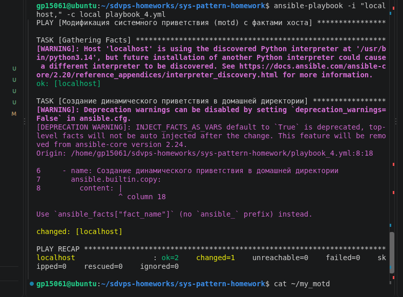
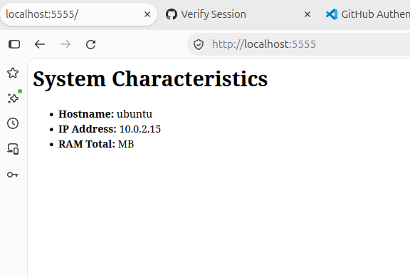

# Домашнее задание к занятию Ansible. Часть 2 - Расулов Рустам


### Инструкция по выполнению домашнего задания

   1. Сделайте `fork` данного репозитория к себе в Github и переименуйте его по названию или номеру занятия, например, https://github.com/имя-вашего-репозитория/git-hw или  https://github.com/имя-вашего-репозитория/7-1-ansible-hw).
   2. Выполните клонирование данного репозитория к себе на ПК с помощью команды `git clone`.
   3. Выполните домашнее задание и заполните у себя локально этот файл README.md:
      - впишите вверху название занятия и вашу фамилию и имя
      - в каждом задании добавьте решение в требуемом виде (текст/код/скриншоты/ссылка)
      - для корректного добавления скриншотов воспользуйтесь [инструкцией "Как вставить скриншот в шаблон с решением](https://github.com/netology-code/sys-pattern-homework/blob/main/screen-instruction.md)
      - при оформлении используйте возможности языка разметки md (коротко об этом можно посмотреть в [инструкции  по MarkDown](https://github.com/netology-code/sys-pattern-homework/blob/main/md-instruction.md))
   4. После завершения работы над домашним заданием сделайте коммит (`git commit -m "comment"`) и отправьте его на Github (`git push origin`);
   5. В личном кабинете прикрепите и отправьте ссылку на решение в виде md-файла в вашем Github.
   6. Любые вопросы по выполнению заданий спрашивайте в разделе “Вопросы по заданию” в личном кабинете.

Желаем успехов в выполнении домашнего задания!

### Дополнительные материалы, которые могут быть полезны для выполнения задания

1. [Руководство по оформлению Markdown файлов](https://gist.github.com/Jekins/2bf2d0638163f1294637#Code)

---

### Задание 1


1. **Плейбук №1 (`playbook_1.yml`)** создает директорию `/opt/kafka`, скачивает архив Apache Kafka и распаковывает его.
2. **Плейбук №2 (`playbook_2.yml`)** устанавливает пакет `tuned` из репозитория, запускает его службу в качестве демона через systemd и добавляет в автозагрузку.
3. **Плейбук №3 (`playbook_3.yml`)** перезаписывает приветствие системы в файле `/etc/motd`, используя внутреннюю переменную для задания текста.


#Код плейбука №1:
```yaml
---
- name: Скачивание и распаковка Apache Kafka
  hosts: all
  become: true
  tasks:
    - name: Создание папки для распаковки архива
      ansible.builtin.file:
        path: /opt/kafka
        state: directory
        mode: '0755'

    - name: Скачивание архива и его распаковка
      ansible.builtin.unarchive:
        src: https://apache.org
        dest: /opt/kafka
        remote_src: true


*#Код плейбука №2:
```yaml
---
- name: Установка и настройка сервиса tuned
  hosts: all
  become: true
  tasks:
    - name: Установка пакета tuned
      ansible.builtin.package:
        name: tuned
        state: present

    - name: Запуск tuned и добавление его в автозагрузку
      ansible.builtin.systemd:
        name: tuned
        state: started
        enabled: true


#Код плейбука №3:
```yaml
---
- name: Изменение системного приветствия (motd)
  hosts: all
  become: true
  vars:
    custom_motd: "Welcome to Rustam Rasulov's managed server! Authorized access only.\n"
  tasks:
    - name: Запись нового приветствия в файл /etc/motd
      ansible.builtin.copy:
        content: "{{ custom_motd }}"
        dest: /etc/motd
        mode: '0644'


---

### Задание 2

Выполнена модификация плейбука для настройки динамического приветствия системы. Из-за ограничений прав доступа локальной среды решение адаптировано для генерации файла приветствия `my_motd` в домашней директории пользователя. В решении используются системные факты Ansible (`ansible_hostname` и `ansible_default_ipv4.address`) для автоматического вывода параметров управляемого хоста при входе.

#Код модифицированного плейбука (`playbook_4.yml`):
```yaml
---
- name: Модификация системного приветствия (motd) с фактами хоста
  hosts: all
  become: false
  tasks:
    - name: Создание динамического приветствия в домашней директории
      ansible.builtin.copy:
        content: |
          =======================================================
          Welcome to the managed server!
          Hostname: {{ ansible_hostname }}
          IP Address: {{ ansible_default_ipv4.address }}

          Have a great day, System Administrator!
          =======================================================
        dest: ~/my_motd
        mode: '0644'
```

#Результат выполнения плейбука и проверки файла:
 (img/task2_result1.png)

---

### Задание 3


Создана полноценная структура Ansible-роли `apache_role` для автоматического развертывания веб-сервера Apache, настройки динамической веб-страницы с характеристиками системы (CPU, RAM, HDD, IP) через шаблонизатор Jinja2, а также проверки доступности сайта. Архив с ролью `apache_role.tar.gz` добавлен в корень репозитория.

**Код главного плейбука запуска (`playbook_5.yml`):**
```yaml
---
- name: Применение роли настройки веб-сервера Apache
  hosts: all
  become: true
  roles:
    - apache_role
```

**Файл основных задач роли (`roles/apache_role/tasks/main.yml`):**
```yaml
---
- name: Установка веб-сервера Apache
  ansible.builtin.package:
    name: apache2
    state: present

- name: Конфигурация веб-страницы по умолчанию (index.html)
  ansible.builtin.template:
    src: index.html.j2
    dest: /var/www/html/index.html
    mode: '0644'
  notify: restart apache

- name: Запуск Apache и добавление в автозагрузку
  ansible.builtin.service:
    name: apache2
    state: started
    enabled: true

- name: Проверка доступности веб-сайта (ожидаем HTTP 200)
  ansible.builtin.uri:
    url: "http://localhost"
    status_code: 200
  register: web_check

- name: Вывод статуса проверки
  ansible.builtin.debug:
    msg: "Сайт доступен, код ответа: {{ web_check.status }}"
```

**Шаблон страницы с фактами (`roles/apache_role/templates/index.html.j2`):**
```html
<!DOCTYPE html>
<html>
<head>
    <title>Apache Managed by Ansible</title>
</head>
<body>
    <h1>System Characteristics</h1>
    <ul>
        <li><strong>Hostname:</strong> {{ ansible_hostname }}</li>
        <li><strong>IP Address:</strong> {{ ansible_default_ipv4.address }}</li>
        <li><strong>CPU Model:</strong> {{ ansible_processor[-1] if ansible_processor is defined and ansible_processor else 'N/A' }}</li>
        <li><strong>RAM Total:</strong> {{ ansible_memtotal_mb }} MB</li>
        <li><strong>First HDD Size:</strong> {{ ansible_devices.sda.size if 'sda' in ansible_devices else 'N/A' }}</li>
    </ul>
</body>
</html>

**Дополнительный скриншот работающей страницы на порту 5555:**
